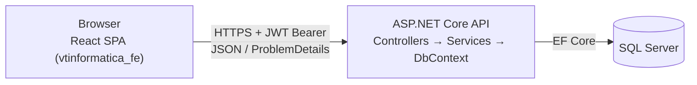

# VTInformatica – API (back end)

[🇮🇹 Italiano](README.md) · 🇬🇧 English

REST API for an e-commerce site selling PC tech products: catalogue, cart, orders, reviews, accounts and a role-based back office (`Admin`, `Seller`, `Customer`). The front end lives in [vtinformatica_fe](https://github.com/Anacronistico00/vtinformatica_fe).

It started as a course final project (tag `v1-epicode`), then went through an audit and was reworked milestone by milestone (`v2-m1` … `v2-m4-be`). The [Before / after](#before--after) and [How I worked with AI](#how-i-worked-with-ai) sections tell the story.

## Stack

- ASP.NET Core Web API (net10.0, .NET 10 LTS), Entity Framework Core 10, SQL Server
- ASP.NET Identity + JWT Bearer, Serilog, Swagger
- Tests: xUnit + `WebApplicationFactory`, in-memory SQLite (no secrets, no SQL Server); integration tests on a real SQL Server with Testcontainers
- CI: GitHub Actions (build and test; separate job with SQL Server in a container)

## Architecture



- `Controllers/`: thin, one per resource. They validate input, call the service and map the response.
- `Services/` + `Interfaces/`: business logic; operations touching several tables (order + stock + cart) run in a single transaction.
- `Mapping/`: one entity → DTO mapping per resource. Entities never leave the API.
- `Errors/`: global exception handler; every error is a `ProblemDetails` with a stable `code` and a `traceId`.
- The user's identity always comes from the JWT claims, never from the route or body (`/me` routes).

## Running locally

Prerequisites: .NET 10 SDK, SQL Server (Express is fine), `dotnet-ef` (`dotnet tool install -g dotnet-ef`).

1. **Clone both repos** side by side (the FE end-to-end tests expect `../VTInformatica`):

   ```bash
   git clone https://github.com/Anacronistico00/VTInformatica.git
   git clone https://github.com/Anacronistico00/vtinformatica_fe.git
   ```

2. **Database.** Run `DatabaseScript.sql` (roles and sample data) in SQL Server Management Studio, then set the connection string in `VTInformatica/appsettings.json` or, better, in User Secrets:

   ```bash
   cd VTInformatica
   dotnet user-secrets set "ConnectionStrings:DefaultConnection" "Server=YOUR_SERVER;Database=VTInformatica;Trusted_Connection=True;TrustServerCertificate=True;" --project VTInformatica
   ```

   Apply the migrations that came after the script (take a backup first if the DB holds data you care about):

   ```bash
   dotnet ef database update --project VTInformatica
   ```

3. **JWT key.** It is not in the repository: without `Jwt:SecurityKey` (at least 32 characters) the API refuses to start.

   ```bash
   dotnet user-secrets set "Jwt:SecurityKey" "<key of at least 32 characters>" --project VTInformatica
   ```

   In production use the `Jwt__SecurityKey` environment variable. The key used in the past is in this public repo's git history: treat it as compromised and never reuse it. `Jwt:Issuer`, `Jwt:Audience` and `Jwt:ExpiresInMinutes` stay in `appsettings.json`.

4. **Start the API:**

   ```bash
   dotnet run --project VTInformatica --launch-profile https
   ```

   It listens on `https://localhost:7286` (Swagger in Development). CORS allows `http://localhost:5173` by default; add other origins with environment variables, e.g. `Cors__AllowedOrigins__1=http://localhost:5174` (needed by the FE end-to-end tests).

5. **First admin, via the DB.** There is no endpoint to create admins (yet): every registration creates a `Customer`. Register the user from the FE (or Swagger), then grant the role:

   ```sql
   INSERT INTO AspNetUserRoles (UserId, RoleId)
   SELECT u.Id, r.Id
   FROM AspNetUsers u, AspNetRoles r
   WHERE u.Email = 'your@email.com' AND r.Name = 'Admin';
   ```

   Then log in again: the role is in the token.

6. **Front end:** follow the [FE README](https://github.com/Anacronistico00/vtinformatica_fe#readme) (`.env.local` with `VITE_API_URL=https://localhost:7286`).

## Tests

```bash
dotnet test VTInformatica.sln
```

Tests use in-memory SQLite and a test JWT key: no setup, no Docker.

### Integration tests on SQL Server

```bash
dotnet test VTInformatica.IntegrationTests
```

The project is outside `VTInformatica.sln`, so `dotnet test VTInformatica.sln` stays fast. It starts an `mssql/server:2022` container with Testcontainers (Docker required), creates an empty database per test and applies the **real migrations**. It checks: a real stock race (12 parallel checkouts on 7 items: exactly 3 succeed, the rest get 409 `insufficient_stock`, stock never negative), the 547 safety net on delete (409 `resource_in_use`), `OrderNumber` uniqueness, `Down` and `Up` of every migration on an empty DB. Without Docker the tests **fail** with a clear message; they are never skipped. Alternatively point `INTEGRATION_SQLSERVER` at an existing SQL Server (connection string to `master`; the `vt_it_*` databases it creates are dropped at the end). In CI they run in the `integration` job.

The end-to-end tests (real browser + BE + SQL Server) live in the FE repo: see the E2E section of its README.

## Before / after

Numbers are **recomputed from the tags** (clean worktree per tag, `dotnet build --no-incremental`, `dotnet test`, `git diff --shortstat v1-epicode <tag>`; on the FE side `npm ci`, `npm run lint`, `npm test`, `npm run build`, `npm audit`), not copied from reports. The FE only has the tags `v1-epicode` and `v2-m4` (all its changes belong to M4), so the middle columns have no FE measurement.

| | `v1-epicode` | `v2-m1` | `v2-m2` | `v2-m3` | `v2-m4-be` / FE `v2-m4` |
|---|---:|---:|---:|---:|---:|
| BE tests (xUnit) | 0 | 42 | 54 | 240 | **243** |
| FE tests (Vitest) | 0 | – | – | – | **93** (+ 8 E2E flows) |
| `dotnet build` warnings (Release, clean) | 114 | 112 | 110 | **0** | **0** |
| FE lint (`npm run lint`) | 5 problems (2 errors, 3 warnings) | – | – | – | **0** |
| FE build warnings | 1 (chunk > 500 kB) | – | – | – | 1 (unchanged) |
| FE `npm audit` | 16 (12 high, 2 moderate, 2 low) | – | – | – | **0** |
| CI | none | BE build + test | same | same | BE: build + test; FE: lint + test + build |
| BE `.cs` files (tracked) | 96 | 108 | 117 | 174 | 176 |
| FE `.js/.jsx` files in `src/` | 52 | – | – | – | 86 |
| Diff vs `v1-epicode` (BE) | – | 27 files, +1620 −12 | 41 files, +3520 −93 | 172 files, +14558 −1459 | 175 files, +14720 −1457 |
| Diff vs `v1-epicode` (FE) | – | – | – | – | 87 files, +8418 −1505 |

Notes:

- Diff lines include tests and migrations (most of the growth).
- The 8 E2E flows were not re-run for this table: they only run locally, not in CI.
- The FE CI does not run the E2E tests (it would need SQL Server on the runner).

Audit items closed, per tag (details in [`docs/AUDIT-prima.md`](docs/AUDIT-prima.md), written in Italian):

- **`v2-m1`**: test project + CI; `Customer` as the default role (every registration used to create an Admin); IDOR on cart and orders; cancel/restore order without ownership check; `UpdateUser` without `[Authorize]`; JWT key out of the repo; restricted CORS.
- **`v2-m2`**: historical price on `OrderItem`; transactional checkout with atomic stock decrement; quantity validation (400/409/404).
- **`v2-m3`**: global error handler + `ProblemDetails` with `code`; centralised mapping; `AsNoTracking`, pagination (`X-Total-Count`) and order queries; product soft delete; account reactivation; login without user enumeration; `RequireUniqueEmail`; build warnings 110 → 0.
- **`v2-m4-be`**: `GET /Review/me` for the FE (+3 tests).
- **FE `v2-m4`**: single `apiClient`, `VITE_API_URL`, token in one place, 401 → logout, no emails in URLs (`/me`), tests and CI, lint and `npm audit` at 0, paginated back office with `expectedQuantity`.

## How I worked with AI

I used Claude Code for most of the code. The process changed over time.

- **Initial audit as the source of truth.** Before touching code I had an audit produced and reviewed ([`docs/AUDIT-prima.md`](docs/AUDIT-prima.md), in Italian): problems ranked by severity plus starting metrics. The baseline is never rewritten. Each slice appends a status section: closed, moved, out of scope.
- **Milestones and slices.** The audit became milestones (M0–M4), split into small slices: one task, one branch, small commits, PR into `develop` with green CI, `main`/`master` only at the end of a milestone with an annotated tag.
- **M1–M2: everything approved by hand, plans reviewed by a second model.** I approved every agent action. I approved every local commit by hand after checking it; if something was wrong, I wrote a fix prompt. I reviewed every plan, produced in plan mode, in a separate conversation with another model acting as reviewer, and only then gave the agent the go-ahead. The early plans are not saved as files: what remains is plan mode and the review conversation. From M3c1 on the plans are in `docs/` ([`PIANO-M3c1`](docs/PIANO-M3c1.md), [`PIANO-M3c2`](docs/PIANO-M3c2.md), [`PIANO-M3d`](docs/PIANO-M3d.md), [`PIANO-review-mine`](docs/PIANO-review-mine.md), in Italian). The review produced concrete corrections:
  - **Role seed drift.** Roles were seeded with `Guid.NewGuid()`: a new migration would have deleted and re-inserted the roles, emptying `AspNetUserRoles`. Found before generating the migration. Fixed GUIDs, identical to the existing DBs, plus a test comparing model and snapshot.
  - **Concurrency test measuring at the wrong point.** It read stock after the rollback, so it proved nothing about the decrement. SQLite cannot run real parallel requests: an interceptor deterministically simulates the concurrent ordering, and the test measures stock right after the `UPDATE`, before the rollback. The real race lives in `VTInformatica.IntegrationTests`, on a real SQL Server.
  - **Slices too large.** M3 was a single block. I split it (a1, a2, b, c1, c2, d) so each piece could be reviewed and reverted on its own.
  - **Parallel `/me` routes.** To move identity into the token I did not break the FE: `/Cart/me` and `/Order/me` were added next to the `{email}` routes, which stayed `[Obsolete]` until the FE had migrated and were removed afterwards.
- **Test-first, red commit → fix.** For every flaw or bug: first a failing test (`test: red - …` commit), then the minimal fix. The git history shows the pairs.
- **Manual migration checks on SQL Server.** The tests run on SQLite, which is not SQL Server. For every migration: DB backup, `database update`, `Down` and `Up`, check the counts before and after (`AspNetUserRoles`, products, orders).
- **From M3c: autonomy with a deny list.** Once rules and process had settled, the agent worked autonomously within explicit limits. The deny list lives in `.claude/settings.json` (force push, `git reset --hard`, `git filter-repo`, `rm -rf`, reading `.env*` and secrets). The `CLAUDE.md` rules forbid direct push and merge to `main` and `develop`: everything goes through a PR.
- **E2E tests found the NavBar crash.** It was already noted in the initial audit, but tests with a simulated network never reproduced it. Playwright against the real BE and DB did. When persistence dropped an expired slice (expired token, cart idle for over an hour), redux-persist's `autoMergeLevel1` copied `undefined` over the initial state and `state.auth` and `state.cart` were `undefined` on startup. Fixed test-first: dropped slices fall back to the initial state.

What the AI did not replace: deciding what is in scope, checking the numbers, trying migrations on the real DB, reading the diff before merging.

## Known limits and next steps

From the audit ("out of scope" sections and future milestones):

- **SuperAdmin and email.** Admins are currently created by hand in the DB. Planned: a `SuperAdmin` role, `POST /Account/admins` with an email invitation (single-use, expiring Identity token), `POST /Account/set-password`, protection of the last SuperAdmin. Prerequisite: an `IEmailSender` (Mailpit/smtp4dev in development, SMTP in production); the same infrastructure enables "forgot password".
- **Email → id.** The `{email}` routes of Cart and Order have been removed: only `/me` is left. Still to do: migrating the key from email to `UserId` in the DB, since cart and orders are still tied to the email (`Cart.Email`, `Order.CustomerEmail`).
- **httpOnly cookie.** The JWT sits in `localStorage` (via redux-persist): an XSS can read it. The fix is an httpOnly cookie + refresh token, which needs BE changes. A CSP must be set as an HTTP header at deploy time.
- **Orders per user.** An admin cannot filter orders by user (after the `{email}` routes were removed only the paginated `GET /Order` is left). Proposal: `GET /Order?customerId=`, Admin only.
- **Seller in the back office.** The BE lets `Seller` manage products and categories; the FE back office is `Admin`-only.

## Contact

- 📧 viktoryturiaci2323@gmail.com
- 💼 [Vittorio Turiaci](https://www.linkedin.com/in/vittorio-turiaci-2646a9333/)
