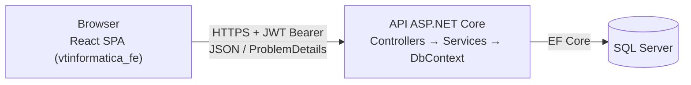

# VTInformatica – API (back-end)

🇮🇹 Italiano · [🇬🇧 English](README.en.md)

API REST di un e-commerce di prodotti tech per PC: catalogo, carrello, ordini, recensioni, account e backoffice per ruoli (`Admin`, `Seller`, `Customer`). Il front-end è in [vtinformatica_fe](https://github.com/Anacronistico00/vtinformatica_fe).

Nato come progetto di fine corso (tag `v1-epicode`), è stato poi sottoposto a un audit e rifatto per milestone (`v2-m1` … `v2-m4-be`). Le sezioni [Prima / dopo](#prima--dopo) e [Come ho lavorato con l'AI](#come-ho-lavorato-con-lai) raccontano come.

## Stack

- ASP.NET Core Web API (net10.0, .NET 10 LTS), Entity Framework Core 10, SQL Server
- ASP.NET Identity + JWT Bearer, Serilog, Swagger
- Test: xUnit + `WebApplicationFactory`, SQLite in-memory (nessun segreto né SQL Server per i test)
- CI: GitHub Actions (restore, build Release, test)

## Architettura



- `Controllers/`: sottili, un controller per risorsa. Validano l'input, chiamano il service, mappano la risposta.
- `Services/` + `Interfaces/`: logica di business; le operazioni che toccano più tabelle (ordine + stock + carrello) stanno in una sola transazione.
- `Mapping/`: un solo punto di mapping entity → DTO per risorsa. Le entity non escono mai dall'API.
- `Errors/`: gestore globale delle eccezioni; ogni errore è un `ProblemDetails` con `code` stabile e `traceId`.
- L'identità dell'utente viene sempre dai claim del JWT, mai da route o body (route `/me`).

## Avvio in locale

Prerequisiti: .NET 10 SDK, SQL Server (anche Express), `dotnet-ef` (`dotnet tool install -g dotnet-ef`).

1. **Clona entrambi i repo** uno accanto all'altro (gli E2E del FE si aspettano `../VTInformatica`):

   ```bash
   git clone https://github.com/Anacronistico00/VTInformatica.git
   git clone https://github.com/Anacronistico00/vtinformatica_fe.git
   ```

2. **Database.** Esegui `DatabaseScript.sql` (ruoli e dati di esempio) in SQL Server Management Studio, poi imposta la stringa di connessione in `VTInformatica/appsettings.json` oppure, meglio, nei User Secrets:

   ```bash
   cd VTInformatica
   dotnet user-secrets set "ConnectionStrings:DefaultConnection" "Server=TUO_SERVER;Database=VTInformatica;Trusted_Connection=True;TrustServerCertificate=True;" --project VTInformatica
   ```

   Applica le migration successive allo script (con un backup prima, se il DB ha dati che ti interessano):

   ```bash
   dotnet ef database update --project VTInformatica
   ```

3. **Chiave JWT.** Non è nel repository: senza `Jwt:SecurityKey` (almeno 32 caratteri) l'API non parte.

   ```bash
   dotnet user-secrets set "Jwt:SecurityKey" "<chiave di almeno 32 caratteri>" --project VTInformatica
   ```

   In produzione si usa la variabile d'ambiente `Jwt__SecurityKey`. La chiave usata in passato è nella storia git di questo repo pubblico: è compromessa e non va riutilizzata. `Jwt:Issuer`, `Jwt:Audience` e `Jwt:ExpiresInMinutes` restano in `appsettings.json`.

4. **Avvia l'API:**

   ```bash
   dotnet run --project VTInformatica --launch-profile https
   ```

   Ascolta su `https://localhost:7286` (Swagger in Development). CORS ammette di default `http://localhost:5173`; altre origini si aggiungono con variabili d'ambiente, ad esempio `Cors__AllowedOrigins__1=http://localhost:5174` (serve agli E2E del FE).

5. **Primo admin, via DB.** Non esiste (ancora) un endpoint per creare admin: ogni registrazione crea un `Customer`. Registra l'utente dal FE (o da Swagger), poi assegnagli il ruolo:

   ```sql
   INSERT INTO AspNetUserRoles (UserId, RoleId)
   SELECT u.Id, r.Id
   FROM AspNetUsers u, AspNetRoles r
   WHERE u.Email = 'tua@email.it' AND r.Name = 'Admin';
   ```

   Poi rifai il login: il ruolo sta nel token.

6. **Front-end:** segui il [README del FE](https://github.com/Anacronistico00/vtinformatica_fe#readme) (`.env.local` con `VITE_API_URL=https://localhost:7286`).

## Test

```bash
dotnet test VTInformatica.sln
```

I test usano SQLite in-memory e una chiave JWT di test: nessuna configurazione. Gli E2E (browser + BE + SQL Server veri) stanno nel repo del FE: vedi la sezione E2E del suo README.

## Prima / dopo

Numeri **ricalcolati dai tag** (worktree pulito per tag, `dotnet build --no-incremental`, `dotnet test`, `git diff --shortstat v1-epicode <tag>`; lato FE `npm ci`, `npm run lint`, `npm test`, `npm run build`, `npm audit`), non copiati dai report. Il FE ha solo i tag `v1-epicode` e `v2-m4` (tutte le sue modifiche sono M4), quindi nelle colonne intermedie non c'è una misura FE.

| | `v1-epicode` | `v2-m1` | `v2-m2` | `v2-m3` | `v2-m4-be` / FE `v2-m4` |
|---|---:|---:|---:|---:|---:|
| Test BE (xUnit) | 0 | 42 | 54 | 240 | **243** |
| Test FE (Vitest) | 0 | – | – | – | **93** (+ 8 flussi E2E) |
| Avvisi `dotnet build` (Release, da zero) | 114 | 112 | 110 | **0** | **0** |
| Lint FE (`npm run lint`) | 5 problemi (2 errori, 3 avvisi) | – | – | – | **0** |
| Avvisi build FE | 1 (chunk > 500 kB) | – | – | – | 1 (invariato) |
| `npm audit` FE | 16 (12 high, 2 moderate, 2 low) | – | – | – | **0** |
| CI | nessuna | build + test BE | idem | idem | BE: build + test; FE: lint + test + build |
| File `.cs` BE (tracciati) | 96 | 108 | 117 | 174 | 176 |
| File `.js/.jsx` FE in `src/` | 52 | – | – | – | 86 |
| Diff vs `v1-epicode` (BE) | – | 27 file, +1620 −12 | 41 file, +3520 −93 | 172 file, +14558 −1459 | 175 file, +14720 −1457 |
| Diff vs `v1-epicode` (FE) | – | – | – | – | 87 file, +8418 −1505 |

Note:

- Le righe di diff includono test e migration (gran parte dell'aumento).
- Gli 8 flussi E2E non sono rieseguiti per questa tabella: girano solo in locale, non in CI.
- La CI del FE non esegue gli E2E (servirebbe SQL Server nel runner).

Voci dell'audit chiuse, per tag (dettaglio in [`docs/AUDIT-prima.md`](docs/AUDIT-prima.md)):

- **`v2-m1`**: progetto di test + CI; ruolo `Customer` di default (prima ogni registrazione creava un Admin); IDOR su carrello e ordini; cancella/ripristina ordine senza controllo di proprietà; `UpdateUser` senza `[Authorize]`; chiave JWT fuori dal repo; CORS ristretto.
- **`v2-m2`**: prezzo storico su `OrderItem`; checkout transazionale con decremento atomico dello stock; validazione delle quantità (400/409/404).
- **`v2-m3`**: gestore errori globale + `ProblemDetails` con `code`; mapping centralizzato; `AsNoTracking`, paginazione (`X-Total-Count`) e query degli ordini; soft delete dei prodotti; riattivazione account; login senza enumerazione; `RequireUniqueEmail`; avvisi di build 110 → 0.
- **`v2-m4-be`**: `GET /Review/me` per il FE (+3 test).
- **FE `v2-m4`**: `apiClient` unico, `VITE_API_URL`, token in un solo posto, 401 → logout, email fuori dagli URL (`/me`), test e CI, lint e `npm audit` a 0, backoffice paginato e con `expectedQuantity`.

## Come ho lavorato con l'AI

Ho usato Claude Code per la maggior parte del codice. Il processo è cambiato nel tempo.

- **Audit iniziale come fonte di verità.** Prima di toccare codice ho fatto produrre e rivedere [`docs/AUDIT-prima.md`](docs/AUDIT-prima.md): problemi per gravità e metriche di partenza. La baseline non si riscrive. Ogni fetta aggiunge sotto una sezione di stato: chiuso, spostato, fuori scope.
- **Milestone e fette.** Dall'audit sono uscite le milestone (M0–M4), divise in fette piccole: un task, un branch, commit piccoli, PR verso `develop` a CI verde, `main`/`master` solo a fine milestone con tag annotato.
- **M1–M2: tutto approvato a mano, piani rivisti da un secondo modello.** Ogni azione dell'agente passava dalla mia approvazione. Ogni commit locale lo approvavo a mano dopo averlo controllato; se qualcosa non andava, scrivevo un prompt di correzione. Ogni piano, prodotto in plan mode, lo rivedevo in una conversazione separata con un altro modello usato come reviewer, e solo dopo davo l'ok all'agente. I piani dei primi passi non sono salvati come file: restano la plan mode e la conversazione di review. Dalla M3c1 in poi i piani sono in `docs/` ([`PIANO-M3c1`](docs/PIANO-M3c1.md), [`PIANO-M3c2`](docs/PIANO-M3c2.md), [`PIANO-M3d`](docs/PIANO-M3d.md), [`PIANO-review-mine`](docs/PIANO-review-mine.md)). La revisione ha prodotto correzioni concrete:
  - **Drift del seed dei ruoli.** I ruoli erano seminati con `Guid.NewGuid()`: una nuova migration avrebbe cancellato e reinserito i ruoli, svuotando `AspNetUserRoles`. Scoperto prima di generare la migration. GUID fissi, uguali a quelli dei DB esistenti, più un test che confronta modello e snapshot.
  - **Test di concorrenza che misurava nel punto sbagliato.** Leggeva lo stock dopo il rollback, quindi non provava nulla sul decremento. Su SQLite non si possono fare richieste parallele vere: un interceptor simula in modo deterministico l'ordine concorrente, e il test misura lo stock subito dopo l'`UPDATE`, prima del rollback. La corsa reale è rimandata a Testcontainers.
  - **Fette troppo grandi.** M3 era un blocco solo. L'ho divisa (a1, a2, b, c1, c2, d) perché ogni pezzo si potesse rivedere e annullare da solo.
  - **Route `/me` in parallelo.** Per portare l'identità nel token non ho rotto il FE: `/Cart/me` e `/Order/me` sono nate accanto alle route con `{email}`, che sono rimaste `[Obsolete]` finché il FE non è migrato e sono state rimosse dopo.
- **Test-first con commit rosso → fix.** Per ogni falla o bug: prima un test che fallisce (commit `test: red - …`), poi il fix minimo. La storia git mostra le coppie.
- **Verifica manuale delle migration su SQL Server.** I test girano su SQLite, che non è SQL Server. Per ogni migration: backup del DB, `database update`, `Down` e `Up`, controllo dei conteggi prima e dopo (`AspNetUserRoles`, prodotti, ordini).
- **Da M3c: autonomia con deny list.** Quando regole e processo si sono stabilizzati, l'agente ha lavorato in autonomia dentro limiti espliciti. La deny list sta in `.claude/settings.json` (force push, `git reset --hard`, `git filter-repo`, `rm -rf`, lettura di `.env*` e dei segreti). Le regole di `CLAUDE.md` vietano push e merge diretti su `main` e `develop`: tutto passa da PR.
- **Gli E2E hanno trovato il crash della NavBar.** Era già annotato nell'audit iniziale, ma i test con rete simulata non lo riproducevano. Playwright contro BE e DB reali sì. Quando la persistenza scartava uno slice scaduto (token scaduto, carrello inattivo da oltre un'ora), `autoMergeLevel1` di redux-persist copiava `undefined` sullo stato iniziale e `state.auth` e `state.cart` erano `undefined` all'avvio. Corretto test-first: gli slice scartati tornano allo stato iniziale.

Cosa l'AI non ha sostituito: decidere cosa è in scope, verificare i numeri, provare le migration sul DB vero, leggere il diff prima del merge.

## Limiti noti e prossimi passi

Dall'audit (sezioni "fuori scope" e milestone future):

- **Test su SQL Server reale in CI.** I test BE usano SQLite in-memory; migration e concorrenza sul DB vero si verificano a mano. Prossimo passo: Testcontainers (o un container `mssql` in GitHub Actions) per il BE e per gli E2E del FE, che oggi girano solo in locale.
- **SuperAdmin ed email.** Oggi gli admin si creano a mano via DB. Previsto: ruolo `SuperAdmin`, `POST /Account/admins` con invito via email (token Identity monouso a scadenza), `POST /Account/set-password`, protezione dell'ultimo SuperAdmin. Prerequisito: un `IEmailSender` (Mailpit/smtp4dev in sviluppo, SMTP in produzione); la stessa infrastruttura abilita "password dimenticata".
- **Email → id.** Le route con `{email}` di Cart e Order sono state rimosse: restano solo `/me`. Resta da migrare la chiave email → `UserId` nel DB: carrello e ordini sono ancora legati all'email (`Cart.Email`, `Order.CustomerEmail`).
- **Cookie httpOnly.** Il JWT sta in `localStorage` (via redux-persist): un XSS può leggerlo. La soluzione è cookie httpOnly + refresh token, che richiede modifiche al BE. Al deploy va impostata una CSP come header HTTP.
- **Ordini per utente.** L'admin non può filtrare gli ordini per utente (dopo la rimozione delle route con `{email}` resta solo `GET /Order` paginato). Proposta: `GET /Order?customerId=`, solo Admin.
- **Seller nel backoffice.** Il BE consente a `Seller` prodotti e categorie, il backoffice del FE è solo per `Admin`.

## Contatti

- 📧 viktoryturiaci2323@gmail.com
- 💼 [Vittorio Turiaci](https://www.linkedin.com/in/vittorio-turiaci-2646a9333/)
